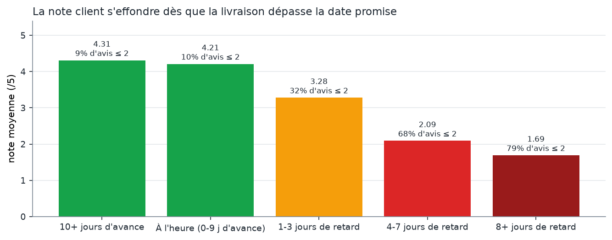
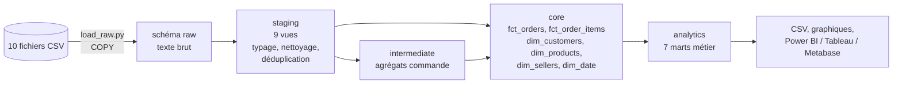
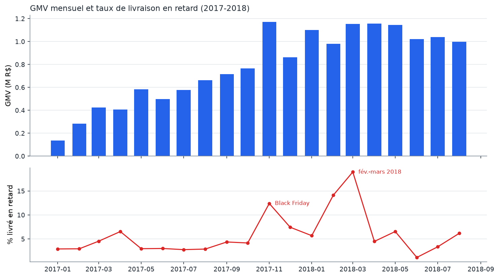
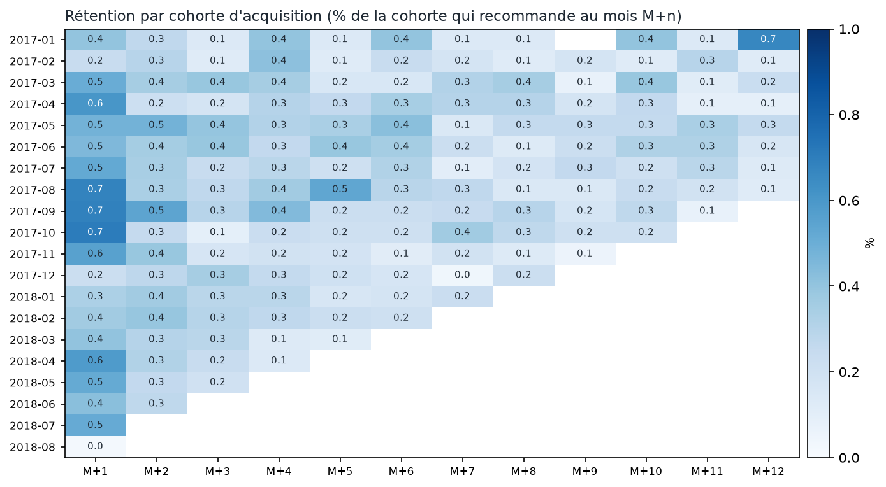
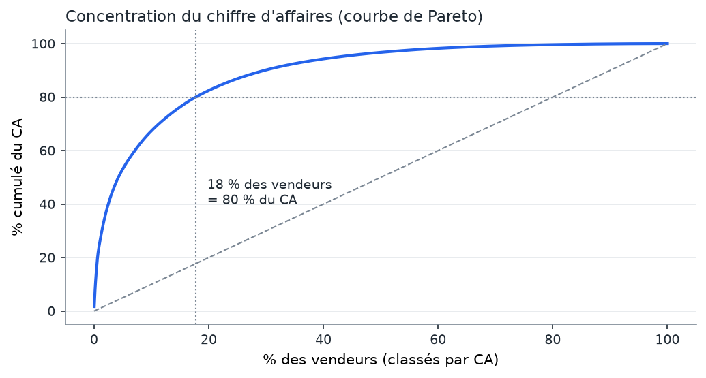
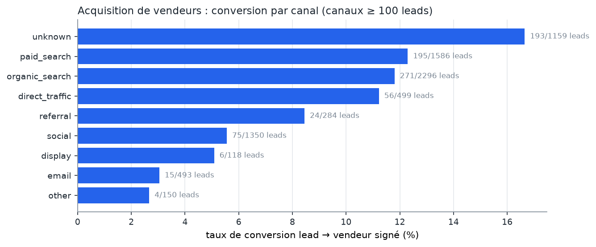
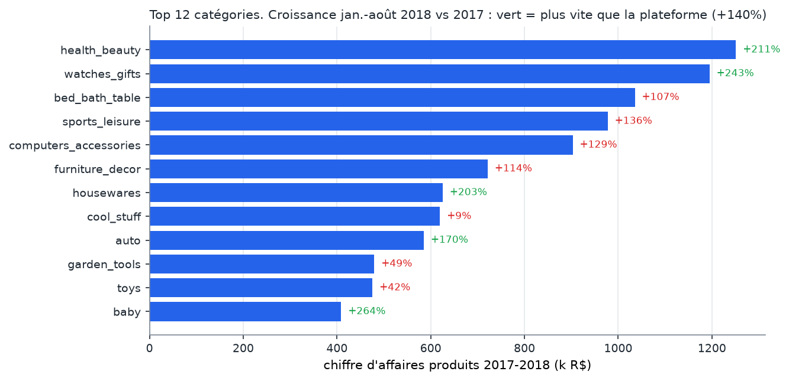
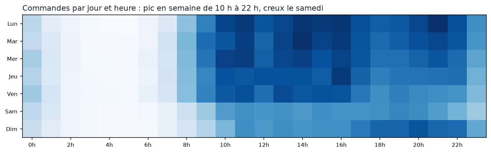

# Olist E-commerce Analytics — SQL, dbt & PostgreSQL

Construction d'un entrepôt de données analytique complet sur 100 000 commandes réelles de la marketplace brésilienne Olist (2016-2018), puis réponse en SQL aux questions qu'une équipe e-commerce se pose : croissance, fidélisation, satisfaction client, logistique, vendeurs et acquisition.

Ce que montre le projet :
- un **pipeline ELT** : CSV bruts → PostgreSQL → modèles dbt en couches (staging, intermediate, marts) ;
- un **modèle en étoile** (faits commandes et lignes de commande, dimensions clients, produits, vendeurs, dates) ;
- **60 tests de qualité** automatisés (unicité, non-nullité, intégrité référentielle, plages de valeurs, rapprochements comptables) ;
- du **SQL avancé** : CTE, fonctions de fenêtre (`ROW_NUMBER`, `LAG`, `NTILE`, `DENSE_RANK`, cumuls), `GROUPING SETS`, `ROLLUP`, `FILTER`, `PERCENTILE_CONT`, `DISTINCT ON`, `generate_series` ;
- l'industrialisation : Docker Compose, Makefile, intégration continue GitHub Actions, documentation dbt avec graphe de lignage.



## Principaux enseignements

| # | Constat | Chiffre clé |
|---|---|---|
| 1 | **Le retard de livraison est le premier facteur d'insatisfaction.** | Note moyenne de 4,28/5 à l'heure, contre 2,26/5 en retard. 79 % d'avis ≤ 2 au-delà de 8 jours de retard. |
| 2 | La date de livraison promise est très prudente : 2 commandes sur 3 arrivent plus de 10 jours en avance. | 12,5 jours de délai moyen pour 23,6 jours promis. |
| 3 | Les pics de retard suivent les pics d'activité. | 12 % de retards au Black Friday 2017, 19 % en mars 2018, contre 3 à 6 % habituellement. |
| 4 | **La fidélisation est quasi inexistante.** | 3 % de clients récurrents. Au mieux 0,7 % d'une cohorte recommande le mois suivant. |
| 5 | Une partie de la « récurrence » est trompeuse. | 30 % des secondes commandes ont lieu le même jour que la première : ce sont des paniers scindés, pas des clients fidélisés. |
| 6 | Les commandes multi-vendeurs sont un point noir. | 2,84/5 de note moyenne, 48 % d'avis négatifs (contre 13 % en mono-vendeur). |
| 7 | La logistique depuis São Paulo vers le Nord-Est et Rio concentre les retards. | Axe SP → RJ : 14 % de retards et 1 152 commandes en retard, le 2ᵉ volume après SP → SP. |
| 8 | Le chiffre d'affaires est concentré sur peu de vendeurs. | 4 % des vendeurs font 50 % du CA, 18 % en font 80 %. |
| 9 | L'acquisition de vendeurs : le search domine, l'e-mail et les réseaux sociaux convertissent mal. | 10,5 % de conversion lead → vendeur signé en moyenne. 12 % sur le search, 5,6 % sur les réseaux sociaux, 3 % par e-mail. Parmi les vendeurs signés avant juin 2018 (au moins 3 mois pour démarrer), seuls 52 % ont réalisé une vente. |

**Recommandations :**
- Surveiller le taux de retard comme un KPI de satisfaction et renforcer la capacité logistique avant les pics saisonniers.
- Traiter en priorité les axes SP → RJ et SP → Nord-Est.
- Lancer un programme de réachat (relance à J+30, la médiane du délai entre deux commandes chez les clients récurrents).
- Mieux accompagner les vendeurs signés jusqu'à leur première vente.

## Architecture



| Couche | Rôle | Exemples |
|---|---|---|
| `raw` | Copie brute des CSV, tout en texte | `raw.orders` |
| `staging` | Typage, nettoyage, renommage, déduplication | `stg_olist__order_reviews` garde un avis par commande |
| `intermediate` | Agrégats réutilisables | paiements et articles agrégés par commande |
| `core` | Modèle en étoile | `fct_orders` (grain commande), `dim_customers` (grain client réel) |
| `analytics` | Tables prêtes pour la BI | KPI mensuels, cohortes, RFM, scorecard vendeurs, funnel d'acquisition |

### Problèmes de qualité traités
- `customer_id` est généré à chaque commande : les analyses clients utilisent `customer_unique_id`. Sans cela, le taux de clients récurrents serait faussement nul.
- 555 commandes ont plusieurs avis, et certains `review_id` sont partagés entre commandes : on conserve le plus récent par commande.
- Deux catégories manquent dans la table de traduction, et 610 produits n'ont pas de catégorie.
- Fautes de frappe dans les noms de colonnes source (`product_name_lenght`), fichier de traduction en UTF-8 avec BOM et fins de ligne Windows.
- Septembre et octobre 2018 sont tronqués, et 2016 est une phase de lancement : les analyses de tendance portent sur janvier 2017 à août 2018 (variables dbt `analysis_start` et `analysis_end`).

### Tests de qualité (dbt)
- **Génériques** : `unique`, `not_null`, `relationships`, `accepted_values`.
- **Génériques maison** (`tests/generic/`) : `accepted_range` et `unique_combination`.
- **Singuliers** :
  - le montant payé correspond aux articles + frais de port pour plus de 99 % des commandes ;
  - aucune livraison n'est datée avant l'achat ;
  - le GMV du mart KPI se rapproche au centime près de la table de faits.

## Analyses

### Croissance et logistique


Le GMV a été multiplié par 2,4 entre janvier-août 2017 et janvier-août 2018. Les deux pics de retard suivent les pics d'activité.

### Fidélisation


`mart_cohort_retention` calcule, pour chaque cohorte mensuelle d'acquisition, la part de clients actifs n mois après leur premier achat. Aucune cellule ne dépasse 0,7 % de rétention mensuelle.

### Vendeurs et acquisition



### Catégories et timing



### Requêtes ad hoc (`olist_dbt/analyses/`)
| Fichier | Question | Techniques SQL |
|---|---|---|
| `q01_seller_pareto.sql` | Combien de vendeurs font 50 / 80 / 95 % du CA ? | cumul par fenêtre, `CROSS JOIN VALUES` |
| `q02_time_to_second_order.sql` | Délai avant la 2ᵉ commande | `LEAD`, `PERCENTILE_CONT` |
| `q03_orders_by_weekday_hour.sql` | Quand les clients commandent-ils ? | `EXTRACT`, agrégation |
| `q04_review_drivers.sql` | Qu'est-ce qui explique les mauvais avis ? | `CASE`, `UNION ALL` |
| `q05_worst_logistics_lanes.sql` | Quels axes vendeur → client concentrent les retards ? | `DISTINCT ON`, `HAVING` |

Les résultats sont exportés en CSV dans `reports/`.

## Lancer le projet

Prérequis : Docker et Python 3.10+.

```bash
git clone https://github.com/martinprevot/olist-sql-dbt-analytics.git
cd olist-sql-dbt-analytics
pip install -r requirements.txt

make all     # PostgreSQL (Docker) + téléchargement + chargement + dbt build + rapports
make docs    # documentation dbt et graphe de lignage sur http://localhost:8080
```

Ou étape par étape :

```bash
docker compose up -d --wait
python scripts/download_data.py
python scripts/load_raw.py
cd olist_dbt && dbt build --profiles-dir . && cd ..
cd olist_dbt && dbt compile --profiles-dir . --select "resource_type:analysis" && cd ..
python scripts/export_reports.py
```

Les marts du schéma `analytics` peuvent être branchés directement dans Power BI, Tableau ou Metabase (connecteur PostgreSQL, `localhost:5433`, base `olist`, utilisateur et mot de passe `olist`).

Le conteneur est exposé sur le port **5433** pour ne pas entrer en conflit avec une installation PostgreSQL locale (Postgres.app, Homebrew) qui occuperait déjà le port 5432. Pour utiliser un autre serveur, définir les variables `PGHOST`, `PGPORT`, `PGUSER`, `PGPASSWORD` et `PGDATABASE`.

## Structure

```
├── docker-compose.yml               # PostgreSQL 16
├── Makefile
├── .github/workflows/ci.yml         # CI : chargement + dbt build à chaque push
├── scripts/
│   ├── download_data.py
│   ├── load_raw.py                  # CSV -> schéma raw (COPY)
│   └── export_reports.py            # analyses -> CSV + graphiques
├── olist_dbt/
│   ├── models/
│   │   ├── staging/                 # 9 modèles + sources + tests
│   │   ├── intermediate/            # 2 modèles
│   │   └── marts/
│   │       ├── core/                # 2 faits + 4 dimensions
│   │       └── analytics/           # 7 marts métier
│   ├── tests/                       # tests singuliers + tests génériques maison
│   ├── macros/                      # safe_divide, generate_schema_name
│   └── analyses/                    # 5 requêtes métier
└── reports/                         # CSV + figures
```

## Stack
SQL · PostgreSQL · dbt · Docker · GitHub Actions · Python (pandas, Matplotlib) · Git

## Données
[Brazilian E-Commerce Public Dataset by Olist](https://www.kaggle.com/datasets/olistbr/brazilian-ecommerce) et [Marketing Funnel by Olist](https://www.kaggle.com/datasets/olistbr/marketing-funnel-olist) (Kaggle, licence CC BY-NC-SA 4.0). Le script de téléchargement utilise un miroir GitHub. En cas d'indisponibilité, télécharger les fichiers depuis Kaggle dans `data/raw/`.
